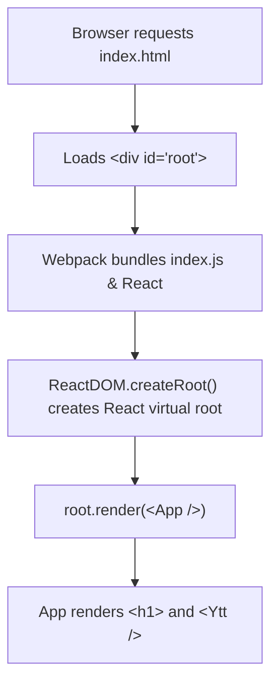

# ⚛️ 01 Basic React — Create React App (CRA) Fundamentals

> **Project Goal**: Understanding the architecture and lifecycle of a traditional React application bootstrapped with `create-react-app`.

---

## 📌 1. What We Did in This Project
- Initialized a classic React application using Create React App.
- Explored the fundamental React file hierarchy: `public/index.html`, `src/index.js`, and `src/App.js`.
- Built and rendered our very first custom component: `Ytt` ([src/ytt.js](file:///f:/React_Js/01basicreact/src/ytt.js)).
- Learned the essential JSX rules (component capitalization, fragments `<></>`).

---

## 💡 2. Core Concepts Learned

### A. How React Mounts into HTML
In `public/index.html`, there is a single empty container:
```html
<div id="root"></div>
```
In `src/index.js`, React attaches to this container using `createRoot`:
```javascript
import React from 'react';
import ReactDOM from 'react-dom/client';
import App from './App';

const root = ReactDOM.createRoot(document.getElementById('root'));
root.render(
  <React.StrictMode>
    <App />
  </React.StrictMode>
);
```

### B. JSX Rules & Principles
1. **Component Names MUST be Capitalized**:
   - `<Ytt />` is treated as a React component.
   - `<ytt />` would be treated as an unknown HTML tag.
2. **Single Parent Element (Fragments)**:
   - A component can only return **one** root JSX element.
   - When you don't want to add unnecessary extra `<div>` wrappers to the DOM, use a Fragment: `<> ... </>` or `<React.Fragment> ... </React.Fragment>`.
3. **Closing Tags**:
   - Every tag must be explicitly closed in JSX (e.g., ``, `<br />`, `<Ytt />`).

---

## ⚙️ 3. Execution Flow



---

## 🧠 4. Quick Revision Cheatsheet

| Topic | Description |
| :--- | :--- |
| **Why `createRoot` instead of legacy `render`?** | React 18 introduced `ReactDOM.createRoot` to enable Concurrent Mode and concurrent features like transitions and automatic batching. |
| **What does `<React.StrictMode>` do?** | A development-only tool that highlights potential problems, detects side-effects by intentionally double-invoking render cycles, and warns about deprecated APIs. (It does not affect production builds). |
| **File extensions in CRA** | CRA's Webpack configuration allows JSX syntax inside both `.js` and `.jsx` files. |

---

## 🛠️ 5. How to Run This Project

> [!IMPORTANT]
> **Why did `npm run dev` fail?**  
> Create React App uses `react-scripts`. Its start script is called `start`, **not** `dev`!

```bash
# Navigate to this project folder
cd 01basicreact

# Run the development server (runs on http://localhost:3000)
npm start

# Build for production
npm run build
```
