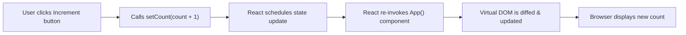

# 🔢 02 Vite App — State Management with `useState` ("Count Machine")

> **Project Goal**: Understanding React's core reactivity model, why ordinary variables fail to update the UI, and mastering the `useState` hook.

---

## 📌 1. What We Did in This Project
Built an interactive counter application ("Count machine") with:
- Increment counter button
- Decrement counter button
- Reset counter button
- Dynamic display reflecting current counter state in real-time.

---

## 💡 2. Core Concepts Learned

### A. Why Can't We Use Regular JavaScript Variables?
If you write:
```javascript
let counter = 15;
const addValue = () => {
    counter = counter + 1;
    console.log(counter); // variable changes in memory, but UI remains 15!
}
```
**Why doesn't the UI update?**  
React does not track changes to regular JavaScript variables. React only re-renders a component when its **State** or **Props** change!

### B. The `useState` Hook
```javascript
import { useState } from 'react';

const [count, setCount] = useState(0);
```
- `count`: The current value of the state.
- `setCount`: The dispatcher/setter function that updates the state and notifies React to schedule a re-render.
- `0`: The initial state value passed to `useState`.

### C. State Batching & Functional Updates
What happens if you run:
```javascript
// Example 1: Repeated calls with direct value
setCount(count + 1);
setCount(count + 1);
setCount(count + 1);
// Result: Count increases by only 1!
```
**Why?** React batches state updates within event handlers. In all three calls, `count` refers to the same value captured during this render cycle.

**The Fix: Functional Updates (Callback form)**:
```javascript
// Example 2: Using the previous state callback
setCount((prevCount) => prevCount + 1);
setCount((prevCount) => prevCount + 1);
setCount((prevCount) => prevCount + 1);
// Result: Count increases by 3!
```
Here, React passes the latest updated state value (`prevCount`) to each consecutive queued update function.

---

## ⚙️ 3. Execution Flow



---

## 🧠 4. Quick Revision Cheatsheet

| Question | Answer |
| :--- | :--- |
| **What triggers a component re-render?** | 1. State change (`useState`/`useReducer`), 2. Prop change, 3. Parent re-render, 4. Context value change. |
| **Is state update synchronous or asynchronous?** | Asynchronous / batched. `count` will not reflect the new value on the very next line of code inside the same function. |
| **Can you pass a function to initial state?** | Yes: `useState(() => expensiveCalculation())`. Lazy initialization runs only once during mount. |

---

## 🛠️ 5. How to Run This Project

```bash
cd 02viteapp
npm install
npm run dev
```
