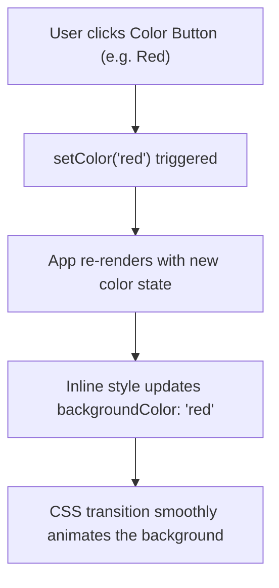

# 🌈 04 Bg React — Dynamic Background & Component Tab Routing

> **Project Goal**: Master dynamic inline CSS styling with React state, passing state setters down to child components, and implementing dynamic component rendering without a router.

---

## 📌 1. What We Did in This Project
- Created a dynamic background color switcher with animated jelly floating buttons (Red, Green, Orange, Olive, Indigo).
- Built a multi-tab single page layout featuring `Home`, `About`, `Projects`, and `Contact` pages.
- Built a floating bottom `Navbar` that receives state and updates the active tab.
- Rendered pages dynamically using an object dictionary lookup pattern.

---

## 💡 2. Core Concepts Learned

### A. Dynamic Inline Styling with React State
React allows dynamic CSS inline styles by passing a JavaScript object to the `style` attribute:
```jsx
const [color, setColor] = useState('olive');

<div
  className="w-full h-screen"
  style={{ 
    backgroundColor: color, 
    transition: 'background-color 0.3s ease' 
  }}
>
```
*Notice double curly braces `{{ ... }}`*: The outer braces enter JSX JavaScript expression mode, and the inner braces define the style object.

### B. Lifting State Up & Passing Setters via Props
The parent component (`App.jsx`) owns the state (`active`, `setActive`) and passes them down to the child `Navbar`:
```jsx
// In App.jsx
<Navbar active={active} setActive={setActive} />

// In Navbar.jsx
function Navbar({ active, setActive }) {
  return (
    <button onClick={() => setActive('Projects')}>
      Projects
    </button>
  );
}
```
This is the fundamental pattern in React for child-to-parent communication.

### C. Dynamic Component Rendering (Dictionary Lookup)
Instead of lengthy `if/else` or `switch` statements:
```jsx
import Home from './pages/Home';
import About from './pages/About';
import Projects from './pages/Projects';
import Contact from './pages/Contact';

const pages = { Home, About, Projects, Contact };

function App() {
  const [active, setActive] = useState('Home');
  const PageComponent = pages[active]; // resolves to the corresponding component

  return <PageComponent />;
}
```

---

## ⚙️ 3. Execution Flow



---

## 🧠 4. Quick Revision Cheatsheet

| Concept | Explanation |
| :--- | :--- |
| **Why not manipulate `document.body.style.backgroundColor` directly?** | Directly mutating the DOM bypasses React's Virtual DOM and reactivity lifecycle, which can cause state synchronization bugs and race conditions. |
| **When to use inline styles vs Tailwind classes?** | Use Tailwind for static and responsive styling; use inline `style={{}}` when CSS properties depend on dynamic runtime JavaScript state (like user-selected hex colors). |

---

## 🛠️ 5. How to Run This Project

```bash
cd 04Bgreact
npm install
npm run dev
```
