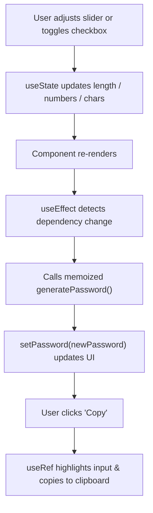

# 🔐 05 PassGen — The React Hooks Masterclass (`useState`, `useCallback`, `useEffect`, `useRef`)

> **Project Goal**: Deep dive into React's foundational hooks by building an interactive, customizable password generator with clipboard copying capabilities.

---

## 📌 1. What We Did in This Project
- Created a dynamic password generator that generates secure passwords using random character selection.
- Added interactive controls:
  - Password length slider (6 to 100 characters).
  - Numbers inclusion checkbox.
  - Special characters inclusion checkbox.
- Integrated a one-click "Copy" button that selects text visually and writes it to the system clipboard.
- Synchronized generator execution whenever any configuration changes.

---

## 💡 2. Core Concepts Learned: The 4 Core Hooks

### 1. `useState` — State Persistence & Reactivity
Used for holding dynamic parameters that need to trigger UI updates:
```javascript
const [length, setLength] = useState(8);
const [numberAllowed, setNumberAllowed] = useState(false);
const [charAllowed, setCharAllowed] = useState(false);
const [password, setPassword] = useState("");
```

### 2. `useCallback` — Function Memoization & Optimization
Without `useCallback`, a function inside a component is **re-created in memory from scratch on every single render**. `useCallback` caches the function instance until its specified dependencies change:
```javascript
const generatePassword = useCallback(() => {
  let pass = "";
  let str = "ABCDEFGHIJKLMNOPQRSTUVWXYZabcdefghijklmnopqrstuvwxyz";
  if (numberAllowed) str += "0123456789";
  if (charAllowed) str += "!@#$%^&*()_+";

  for (let i = 1; i <= length; i++) {
    pass += str.charAt(Math.floor(Math.random() * str.length));
  }

  setPassword(pass);
}, [length, numberAllowed, charAllowed]);
```
*Note*: The dependency array defines when React should re-create this function.

### 3. `useEffect` — Lifecycle & Automatic Execution
`useEffect` handles side-effects (e.g., API calls, DOM changes, invoking recalculations). Here, it automatically triggers `generatePassword()` on component mount and whenever any dependency updates:
```javascript
useEffect(() => {
  generatePassword();
}, [length, numberAllowed, charAllowed, generatePassword]);
```

### 4. `useRef` — Direct DOM Reference Without Re-rendering
`useRef` creates a mutable reference object (`{ current: ... }`) that persists across renders without triggering a re-render when mutated. Here, we use it to access the `<input>` DOM node directly to select text and set selection ranges:
```javascript
const passwordRef = useRef(null);

const copyPasswordToClipboard = useCallback(() => {
  passwordRef.current?.select();                      // Visually highlights input text
  passwordRef.current?.setSelectionRange(0, 999);     // Sets selection range for mobile/desktop
  window.navigator.clipboard.writeText(password);     // Copies to OS clipboard
}, [password]);

// In JSX:
<input ref={passwordRef} value={password} readOnly />
```

---

## ⚙️ 3. Execution Flow



---

## 🧠 4. Quick Revision Cheatsheet

| Hook | Purpose | Triggers Re-render? |
| :--- | :--- | :--- |
| **`useState`** | Stores component reactive state | ✅ **Yes** |
| **`useCallback`** | Caches a function definition between renders | ❌ **No** |
| **`useEffect`** | Runs side-effects after the component renders | ❌ **No** (unless setting state inside it) |
| **`useRef`** | Holds a direct DOM node reference or mutable value | ❌ **No** |

---

## 🛠️ 5. How to Run This Project

```bash
cd 05PassGen
npm install
npm run dev
```
