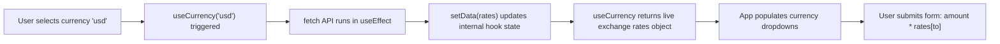

# 💱 06 Api Use — Custom Hooks & Real-World Currency Converter

> **Project Goal**: Learn how to build custom React hooks, consume live external REST APIs, and build reusable controlled form components.

---

## 📌 1. What We Did in This Project
- Created a custom React hook [src/hooks/useCurrancy.js](file:///f:/React_Js/06Apiuse/src/hooks/useCurrancy.js) to fetch real-time exchange rates.
- Built a reusable, accessible [src/components/Input.jsx](file:///f:/React_Js/06Apiuse/src/components/Input.jsx) (`InputBox`) component for currency inputs and dropdown selections.
- Implemented a currency swap feature (reversing "From" and "To" values and currencies simultaneously).
- Calculated conversions dynamically upon form submission.

---

## 💡 2. Core Concepts Learned

### A. What is a Custom Hook?
A custom hook in React is simply a JavaScript function whose name starts with **`use`** (e.g., `useCurrency`) that can call other built-in React hooks (`useState`, `useEffect`). It allows you to extract component logic into reusable functions:

```javascript
// src/hooks/useCurrancy.js
import { useEffect, useState } from "react";

function useCurrency(currency) {
  const [data, setData] = useState({});

  useEffect(() => {
    if (!currency) return;
    const cur = currency.toLowerCase();
    
    fetch(`https://cdn.jsdelivr.net/npm/@fawazahmed0/currency-api@latest/v1/currencies/${cur}.json`)
      .then((res) => res.json())
      .then((res) => {
        if (res && res[cur]) {
          setData(res[cur]);
        }
      })
      .catch((err) => console.error("Failed to fetch currency:", err));
  }, [currency]);

  return data;
}

export default useCurrency;
```

### B. Consuming the Custom Hook
```javascript
// In App.jsx
const currencyInfo = useCurrency(from);
const options = Object.keys(currencyInfo); // Extract currency symbols (e.g. 'inr', 'eur', 'usd')
```

### C. Reusable Controlled Component (`InputBox`)
Instead of duplicating input markup for "From" and "To" fields, we built a single parameterized component:
```jsx
<InputBox
  label="From"
  amount={amount}
  currencyOptions={options}
  onCurrencyChange={(currency) => setFrom(currency)}
  selectCurrency={from}
  onAmountChange={(amt) => setAmount(amt)}
/>
```
Using the `useId()` hook inside `InputBox` generates unique, accessible IDs to bind `<label htmlFor={amountInputId}>` with `<input id={amountInputId} />`.

### D. The Swap Mechanic
Swapping state variables without losing values:
```javascript
const swap = () => {
  setFrom(to);
  setTo(from);
  setConvertedAmount(amount);
  setAmount(convertedAmount);
};
```

---

## ⚙️ 3. Execution Flow



---

## 🧠 4. Quick Revision Cheatsheet

| Question | Answer |
| :--- | :--- |
| **Why must custom hooks start with `use`?** | The React Linter checks for the `use` prefix to enforce the **Rules of Hooks** (e.g., hooks cannot be called inside loops, conditions, or nested functions). |
| **Does each component calling a custom hook share state?** | **No!** Custom hooks share *logic*, not state. Each call to a custom hook creates an independent state instance. |
| **Why use `useId()`?** | To generate unique IDs for accessibility without risking collision across multiple component instances. |

---

## 🛠️ 5. How to Run This Project

```bash
cd 06Apiuse
npm install
npm run dev
```
