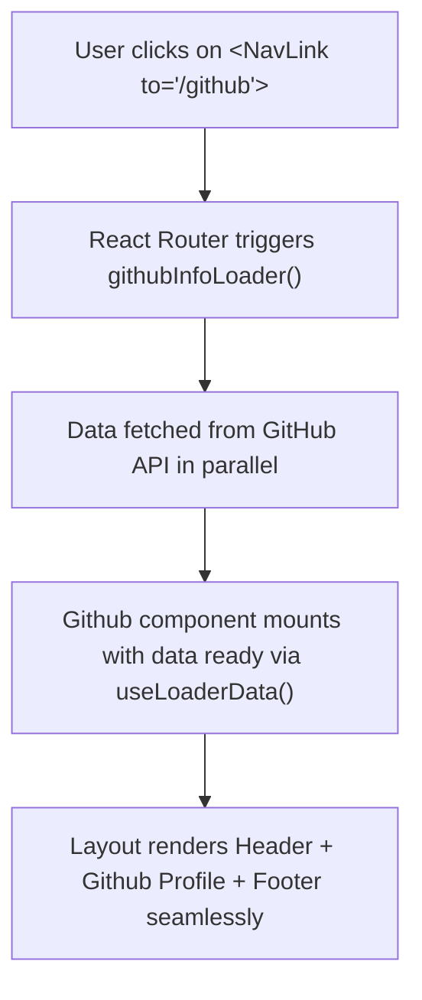

# 🧭 07 React Router — Single Page Application (SPA) Routing & Loaders

> **Project Goal**: Master client-side routing, nested layouts with `Outlet`, dynamic route parameters with `useParams`, and high-performance data prefetching with route `loader` & `useLoaderData`.

---

## 📌 1. What We Did in This Project
- Replaced traditional multi-page page reloads with client-side SPA navigation via `react-router-dom` (v6+).
- Built a nested master layout ([src/Layout.jsx](file:///f:/React_Js/07ReactRouter/src/Layout.jsx)) containing a persistent `Header` and `Footer`, dynamically injecting pages through `<Outlet />`.
- Handled dynamic URL routing to read route parameters in [src/components/User/User.jsx](file:///f:/React_Js/07ReactRouter/src/components/User/User.jsx).
- Implemented route data prefetching using `loader` functions and `useLoaderData` in [src/components/Github/Github.jsx](file:///f:/React_Js/07ReactRouter/src/components/Github/Github.jsx).

---

## 💡 2. Core Concepts Learned

### A. Router Setup (`createBrowserRouter` & `RouterProvider`)
```jsx
// src/main.jsx
import { createBrowserRouter, createRoutesFromElements, Route, RouterProvider } from 'react-router-dom';
import Layout from './Layout';
import { Home, About, Contact, User, Github, githubInfoLoader } from './components';

const router = createBrowserRouter(
  createRoutesFromElements(
    <Route path='/' element={<Layout />}>
      <Route path='' element={<Home />} />
      <Route path='about' element={<About />} />
      <Route path='contact' element={<Contact />} />
      <Route path='user/:userid' element={<User />} />
      <Route 
        loader={githubInfoLoader}
        path='github' 
        element={<Github />} 
      />
    </Route>
  )
);

createRoot(document.getElementById('root')).render(
  <RouterProvider router={router} />
);
```

### B. Nested Routing with `<Outlet />`
In [src/Layout.jsx](file:///f:/React_Js/07ReactRouter/src/Layout.jsx):
```jsx
import { Outlet } from 'react-router-dom';
import Header from './components/Header/Header';
import Footer from './components/Footer/Footer';

function Layout() {
  return (
    <>
      <Header />
      <Outlet />   {/* Child routes render right here */}
      <Footer />
    </>
  );
}
```

### C. `<Link>` & `<NavLink>` vs `<a href>`
- `<a>` tags trigger a **full browser refresh**, resetting React state and reloading all assets.
- `<Link to="...">` intercepts click events and changes the URL via HTML5 History API without reloading the page.
- `<NavLink>` provides an `isActive` callback to easily apply active styles to navigation tabs:
  ```jsx
  <NavLink
    to="/about"
    className={({ isActive }) => (isActive ? "text-orange-700" : "text-gray-700")}
  >
    About
  </NavLink>
  ```

### D. Dynamic Route Params (`useParams`)
In `Route path='user/:userid'`, `:userid` is a variable param:
```jsx
// src/components/User/User.jsx
import { useParams } from 'react-router-dom';

export default function User() {
  const { userid } = useParams(); // Extracts '123' from URL /user/123
  return <div>User Profile: {userid}</div>;
}
```

### E. Data Fetching Optimization with `loader`
Instead of using a classic `useEffect` that triggers a waterfall fetch *after* the component mounts, React Router's `loader` fetches data in parallel **as soon as navigation starts**:
```jsx
// In Github.jsx:
export const githubInfoLoader = async () => {
  const response = await fetch('https://api.github.com/users/Sanket22g');
  return response.json();
};

export default function Github() {
  const data = useLoaderData(); // Data is already ready!
  return <h2>{data.name} - Followers: {data.followers}</h2>;
}
```

---

## ⚙️ 3. Execution Flow



---

## 🧠 4. Quick Revision Cheatsheet

| Feature | Purpose |
| :--- | :--- |
| **`Outlet`** | Placeholder component inside a parent route where child route elements are rendered. |
| **`useParams`** | Returns an object of key/value pairs of URL parameters matching `:paramName`. |
| **`loader` & `useLoaderData`** | Eliminates loading spinners and fetch waterfalls by pre-fetching route data before rendering. |
| **`useNavigate`** | Hook providing programmatic navigation (e.g., `navigate('/dashboard')` after login). |

---

## 🛠️ 5. How to Run This Project

```bash
cd 07ReactRouter
npm install
npm run dev
```
