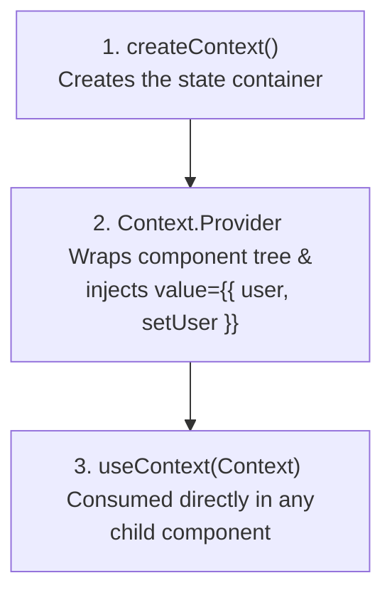

# 🌐 08 Context — React Context API & Solving Prop Drilling

> **Project Goal**: Understand the React Context API to manage global state across components seamlessly without prop drilling.

---

## 📌 1. What We Did in This Project
- Solved the classic React anti-pattern: **Prop Drilling**.
- Created a centralized user authentication context ([src/context/UserContext.js](file:///f:/React_Js/08Context/src/context/UserContext.js)).
- Implemented a Context Provider wrapper component ([src/context/UserContextProvider.jsx](file:///f:/React_Js/08Context/src/context/UserContextProvider.jsx)).
- Built:
  - [src/components/Login.jsx](file:///f:/React_Js/08Context/src/components/Login.jsx) to set the global user state.
  - [src/components/Profile.jsx](file:///f:/React_Js/08Context/src/components/Profile.jsx) to consume and display the global user state without passing props between them.

---

## 💡 2. Core Concepts Learned

### A. The Problem: What is "Prop Drilling"?
When a deeply nested component needs state that is defined high up in the tree, you are forced to pass that state through every intermediate component—even if those intermediate components don't need or care about that state:
```
App (holds user state) ➔ Layout ➔ Dashboard ➔ Sidebar ➔ UserProfile (needs user state)
```
Prop drilling creates tightly coupled, difficult-to-maintain code.

### B. The 3-Step Context API Pattern



#### Step 1: Create the Context
```javascript
// src/context/UserContext.js
import React from "react";
const UserContext = React.createContext();
export default UserContext;
```

#### Step 2: Create the Provider Component
```jsx
// src/context/UserContextProvider.jsx
import React, { useState } from "react";
import UserContext from "./UserContext";

const UserContextProvider = ({ children }) => {
  const [user, setUser] = useState(null);

  return (
    <UserContext.Provider value={{ user, setUser }}>
      {children}
    </UserContext.Provider>
  );
};

export default UserContextProvider;
```

#### Step 3: Consume State with `useContext`
In `Login.jsx` (Writing to context):
```jsx
import React, { useState, useContext } from 'react';
import UserContext from '../context/UserContext';

function Login() {
  const [username, setUsername] = useState('');
  const { setUser } = useContext(UserContext);

  const handleSubmit = (e) => {
    e.preventDefault();
    setUser({ username });
  };

  return <button onClick={handleSubmit}>Submit</button>;
}
```

In `Profile.jsx` (Reading from context):
```jsx
import React, { useContext } from 'react';
import UserContext from '../context/UserContext';

function Profile() {
  const { user } = useContext(UserContext);

  if (!user) return <div>Please Login</div>;
  return <div>Welcome, {user.username}!</div>;
}
```

---

## ⚙️ 3. Execution Flow

1. `UserContextProvider` mounts and holds `user` state initialized to `null`.
2. Both `Login` and `Profile` are siblings under `App.jsx`, yet have **direct access** to `user` and `setUser` via `useContext(UserContext)`.
3. When `Login` calls `setUser({ username })`, the Context Provider value changes.
4. React automatically notifies all subscribers to `UserContext` to re-render, instantly displaying the new username in `Profile`!

---

## 🧠 4. Quick Revision Cheatsheet

| Question | Answer |
| :--- | :--- |
| **When should you use Context API?** | For global data needed by many components (e.g., current authenticated user, UI theme, language/locale, shopping cart). |
| **Does Context API replace Redux / Zustand?** | For small to medium apps, Context API is sufficient. For complex apps with frequent state changes and fine-grained selectors, Redux Toolkit or Zustand are preferred to prevent unnecessary re-renders. |
| **Why can Context trigger unnecessary re-renders?** | Any component that consumes a context will re-render whenever the context `value` reference changes, even if it only uses a property of that value that did not change. |

---

## 🛠️ 5. How to Run This Project

```bash
cd 08Context
npm install
npm run dev
```
