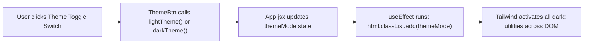

# 🌓 09 Dark Mode — Production-Ready Theme Context & Tailwind Integration

> **Project Goal**: Implement an industry-standard Light/Dark theme switcher utilizing an optimized Context API architecture, custom hooks, and Tailwind CSS dark mode classes.

---

## 📌 1. What We Did in This Project
- Built a modern, sleek Light / Dark mode toggle switch.
- Implemented an advanced, cleaner Context API architecture in a single file ([src/contexts/theme.js](file:///f:/React_Js/09Darkmode/src/contexts/theme.js)).
- Built an interactive toggle button ([src/components/ThemeBtn.jsx](file:///f:/React_Js/09Darkmode/src/components/ThemeBtn.jsx)) and dark-mode-ready cards ([src/components/Card.jsx](file:///f:/React_Js/09Darkmode/src/components/Card.jsx)).
- Synchronized the React theme state with the browser's root HTML element (`<html class="dark">`).

---

## 💡 2. Core Concepts Learned

### A. The Concise Theme Context Pattern
Instead of splitting context into multiple files with separate provider boilerplate, modern React developers combine them into one concise module:

```javascript
// src/contexts/theme.js
import { createContext, useContext } from 'react';

// 1. Create Context with default state and dummy methods for IDE autocompletion
export const ThemeContext = createContext({
  themeMode: 'light',
  darkTheme: () => {},
  lightTheme: () => {},
});

// 2. Export Provider directly
export const ThemeProvider = ThemeContext.Provider;

// 3. Export custom hook for one-line consumption
export default function useTheme() {
  return useContext(ThemeContext);
}
```

### B. Consuming Theme via Custom Hook `useTheme()`
Instead of writing:
```javascript
// ❌ Verbose
import { useContext } from 'react';
import { ThemeContext } from '../contexts/theme';
const { themeMode } = useContext(ThemeContext);
```
Components now write:
```javascript
// ✅ Clean & Ergonomic
import useTheme from '../contexts/theme';
const { themeMode, lightTheme, darkTheme } = useTheme();
```

### C. Synchronizing Theme with the DOM & Tailwind
Tailwind CSS responds to classes on the `<html>` root tag (when configured for `darkMode: "class"` or CSS variables). In [src/App.jsx](file:///f:/React_Js/09Darkmode/src/App.jsx):
```javascript
const [themeMode, setThemeMode] = useState('light');

const lightTheme = () => setThemeMode('light');
const darkTheme = () => setThemeMode('dark');

useEffect(() => {
  const html = document.querySelector('html');
  html.classList.remove('light', 'dark');
  html.classList.add(themeMode);
}, [themeMode]);
```

### D. Writing Tailwind Dark Mode Classes
Tailwind provides the `dark:` variant that applies styles when the parent HTML element has the `.dark` class:
```jsx
<div className="bg-slate-50 dark:bg-slate-950 text-gray-900 dark:text-gray-100">
  <button className="bg-white dark:bg-gray-800 border border-gray-200 dark:border-gray-700">
    Toggle
  </button>
</div>
```

---

## ⚙️ 3. Execution Flow



---

## 🧠 4. Quick Revision Cheatsheet

| Question | Answer |
| :--- | :--- |
| **Why define default values inside `createContext(...)`?** | 1. Provides TypeScript / IDE autocomplete for properties and methods. 2. Provides safe fallback values if a component renders outside the Provider. |
| **How does Tailwind know when to apply `dark:` styles?** | In class mode, Tailwind generates CSS like `.dark .bg-slate-950`. When the `dark` class is attached to `<html class="dark">`, those selectors match. |
| **Why use `useEffect` for the DOM class update?** | Modifying `document.querySelector('html')` is a side-effect that must run *after* React has updated state and finished rendering. |

---

## 🛠️ 5. How to Run This Project

```bash
cd 09Darkmode
npm install
npm run dev
```
